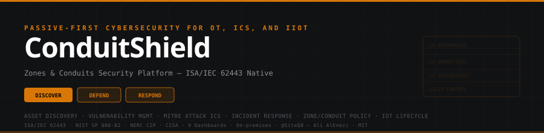
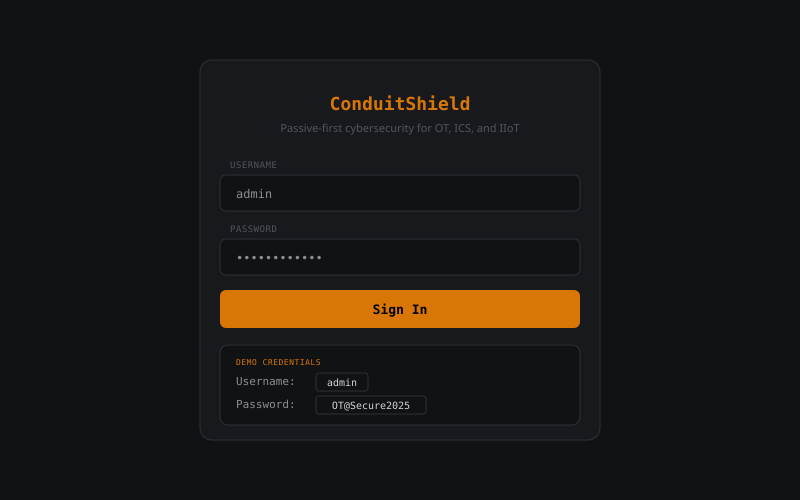
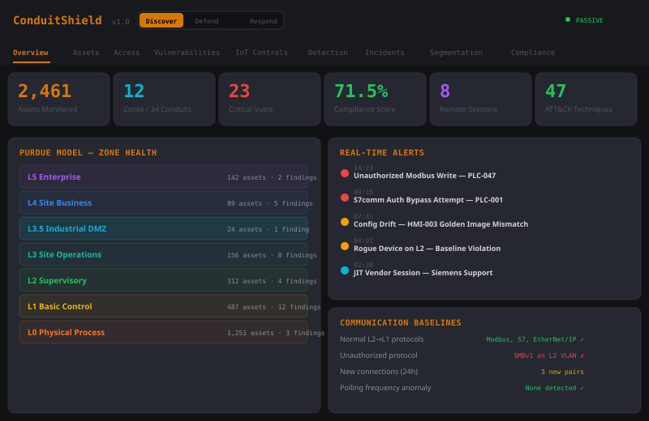
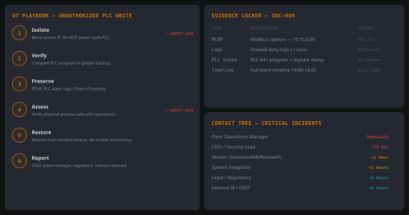

<div align="center">



<br>

[](https://siteq8.github.io/ConduitShield)
[](LICENSE)
[]()
[]()
[]()
[]()

### Passive-first cybersecurity for OT, ICS, and IIoT

**One platform. Three modes. Full OT lifecycle security.**

[Live Dashboard](https://siteq8.github.io/ConduitShield) · [Features](#features) · [Architecture](#architecture) · [Standards](#standards-alignment) · [Quick Start](#quick-start)

</div>

---

## Why ConduitShield

APIs are the #1 attack vector in IT. In OT, the attack surface is the **protocol layer** — Modbus writes, S7comm uploads, DNP3 commands — where a single unauthorized change can halt a plant or endanger safety.

Most cybersecurity tools are built for IT and retrofitted for OT. They actively scan, ignore zones and conduits, treat the plant like a flat LAN, and have no awareness of operational safety.

ConduitShield is **built for OT from the ground up**:

- **Passive-first** — SPAN/TAP visibility, no active scanning unless explicitly approved during a maintenance window
- **Zones & conduits native** — ISA/IEC 62443 segmentation is a first-class concept, not a report add-on
- **Safety-aware** — response automation never disrupts operations without explicit policy gates
- **OT protocol parsing** — Modbus, DNP3, S7comm, EtherNet/IP, OPC UA, BACnet, IEC 104, MQTT, CoAP
- **Three operational modes** — Discover, Defend, Respond — matching how OT security programs mature

---

## Dashboard Access

| Credential | Username | Password |
|-----------|----------|----------|
| **Admin** | `admin` | `OT@Secure2025` |

**Live:** [https://siteq8.github.io/ConduitShield](https://siteq8.github.io/ConduitShield)

---

## Screenshots

### Login Screen



> Demo credentials with click-to-fill. Certificate-backed device trust. Three operational modes: Discover, Defend, Respond.

### Security Overview — Purdue Model, Alerts, Baselines



> Real-time security posture across 7 Purdue zones (L0-L5 + DMZ). Communication baselines detect unauthorized protocols, rogue devices, and polling anomalies. 2,461 monitored assets with 12 zones and 34 conduits.

### Incident Response — OT Playbooks, Evidence Locker, Contact Tree



> Safety-aware 6-step playbook for unauthorized PLC writes with explicit safety gates. Evidence locker with chain of custody (PCAPs, logs, PLC state, timelines). Contact tree with SLA times for operations, CISO, vendors, integrators, legal, and external IR.

---

## Features

### Three Modes

| Mode | Purpose |
|------|---------|
| **Discover** | Asset inventory, topology mapping, zone/conduit definition, protocol baselining |
| **Defend** | Access control, segmentation enforcement, vulnerability management, IoT lifecycle |
| **Respond** | Detection engineering, incident cases, OT playbooks, evidence preservation |

### Platform Modules

| Module | Key Capabilities |
|--------|-----------------|
| **Overview** | Security posture: 2,461 assets, Purdue L0-L5 zone health with conduit counts, real-time alerts, communication baselines (normal protocol detection, rogue device, unauthorized protocol, polling anomaly) |
| **Asset Intelligence** | Passive discovery (SPAN/TAP): vendor, model, serial, firmware, OS, protocol, zone, IP/MAC, owner, criticality. Auto-built topology with protocol map (Modbus, S7comm, OPC UA, EtherNet/IP, DNP3, MQTT). End-of-life tracking with compensating controls |
| **Access & Identity** | JIT remote access with MFA, approval chains, session recording, one-click disconnect. Certificate-backed device trust. RBAC/ABAC role matrix (Operator, Engineer, Vendor, SOC, Admin). SSO/federation (SAML, OAuth2, AD). Default credential detection and forced replacement |
| **Vulnerability & Patch** | ICS-CERT advisory correlation (6 real CVEs). OT patch workflow (assess → test offline → schedule outage → deploy → verify → rollback). SBOM ingest with component-to-asset mapping. Config drift detection with golden image comparison. Compensating control tracking |
| **IoT Lifecycle** | Secure onboarding (4-gate: credentials, certificate, config, access controls). Firmware update validation (signature + SHA-256 checksum + rollback). Device state awareness (healthy/degraded/compromised). Key and certificate lifecycle. Logical access controls on interfaces, ports, APIs |
| **Detection & Analytics** | 47 MITRE ATT&CK for ICS techniques. Process-aware anomaly detection: unexpected writes, unauthorized mode changes, unusual polling, scan storms, engineering uploads, abnormal inter-zone traffic. 14 event sources connected. Threat hunting queries |
| **Incident Response** | P1-P4 cases with zone/conduit impact. OT playbooks with safety gates (never auto-disrupt without policy). Evidence locker (PCAPs, logs, PLC state, timelines) with chain of custody. Contact trees (operations, CISO, vendors, integrators, legal, external IR) |
| **Segmentation Policy** | Zone/conduit policy with allowed protocols, ports, time windows. Change simulation with blast radius preview. DMZ architecture recommendations. Unidirectional gateway placement. Continuous traffic-vs-policy validation |
| **Compliance & Audit** | 6 frameworks: IEC 62443, NIST 800-82, NERC CIP, ATT&CK ICS, CIS v8.1, CISA. 1,247 controls tracked. Audit-ready reports (assets, access, patches, EOL, incidents, exceptions). Platform deployment: on-prem first, lightweight collectors, store-and-forward, HA, API-first, multi-site |

---

## Architecture

```
ConduitShield Platform
│
├── DISCOVER MODE
│   ├── Passive Network Discovery (SPAN/TAP)
│   ├── Full Asset Inventory (vendor, model, firmware, protocol, zone)
│   ├── Auto-built Topology with Purdue Levels
│   ├── Protocol-aware Parsing (Modbus, DNP3, S7comm, CIP, OPC UA)
│   └── Communication Baselines + Rogue Device Detection
│
├── DEFEND MODE
│   ├── Identity & Access Management (RBAC/ABAC, MFA, JIT)
│   ├── Privileged Access Workflow (session recording, command logging)
│   ├── Default Credential Detection & Forced Replacement
│   ├── Vulnerability Correlation (ICS-CERT, vendor advisories)
│   ├── Patch Workflow (assess → test → schedule → deploy → verify → rollback)
│   ├── Compensating Control Tracking
│   ├── Config Drift Detection & Golden Image Comparison
│   ├── SBOM Ingest & Supply Chain Mapping
│   ├── IoT Onboarding & Secure Configuration
│   ├── Certificate & Key Lifecycle Management
│   ├── Firmware Update Validation (signature, checksum, rollback)
│   ├── Zone/Conduit Policy Builder
│   ├── Segmentation Continuous Validation
│   └── Change Simulation (blast radius preview)
│
├── RESPOND MODE
│   ├── Event Collection (OT sensors, HMIs, SCADA, historians, firewalls)
│   ├── Process-aware Anomaly Detection
│   ├── MITRE ATT&CK for ICS Mapping (47 techniques)
│   ├── Audit Log Storage with Integrity Protection
│   ├── Incident Cases (severity, zones, impact, containment)
│   ├── OT-specific Playbooks
│   ├── Evidence Locker (logs, PCAPs, timelines, chain of custody)
│   ├── Safety-aware Response Gates
│   └── Contact Trees (vendors, operations, legal, responders)
│
└── PLATFORM
    ├── On-premises First (optional hybrid analytics)
    ├── Lightweight Collectors for Plants/Substations
    ├── Store-and-forward for Low-bandwidth Sites
    ├── API-first Integration (SIEM, SOAR, CMDB, IAM)
    └── Multi-site Tenancy (enterprise, MSSP)
```

---

## Standards Alignment

| Standard | Version | Coverage |
|----------|---------|----------|
| **ISA/IEC 62443** | 2018 | Zones/conduits, security levels, system requirements, component requirements |
| **NIST SP 800-82** | Rev 3 | OT security guide — network architecture, access control, monitoring |
| **NERC CIP** | v7 | Critical infrastructure protection for bulk electric systems |
| **MITRE ATT&CK for ICS** | v14 | 47 techniques mapped with detection rules and hunting queries |
| **CIS Controls** | v8.1 | Implementation groups 1-3 mapped to OT context |
| **CISA ICS Guidelines** | 2024 | Secure-by-design, default credential elimination, SBOM |
| **NIST IoT Cybersecurity** | NIST IR 8259 | Device identity, logical access, software update, telemetry |

---

## ICS Protocol Support

| Protocol | Port | Standard | Use Case |
|----------|------|----------|----------|
| Modbus/TCP | 502 | IEC 61158 | PLCs, RTUs, sensors |
| DNP3 | 20000 | IEEE 1815 | Substations, water/wastewater |
| S7comm/S7comm+ | 102 | Siemens | S7-300/400/1200/1500 PLCs |
| EtherNet/IP (CIP) | 44818 | IEC 61158 | Rockwell/Allen-Bradley |
| OPC UA | 4840 | IEC 62541 | HMIs, SCADA, historians |
| BACnet/IP | 47808 | ISO 16484-5 | Building management |
| IEC 60870-5-104 | 2404 | IEC 60870 | Power grid SCADA |
| MQTT | 1883 | ISO/IEC 20922 | IoT sensors, telemetry |
| CoAP | 5683 | RFC 7252 | Constrained IoT devices |
| TriStation | 1502 | Schneider | Safety instrumented systems |
| PROFINET | — | IEC 61158 | Siemens automation |
| Foundation Fieldbus | — | IEC 61158 | Process instrumentation |

---

## OT Incident Playbooks

ConduitShield includes OT-specific playbooks designed around safety and operational continuity:

| Playbook | Key Principle |
|----------|---------------|
| **Unauthorized PLC Write** | Isolate source, verify process state BEFORE any PLC action, compare against golden backup |
| **Ransomware on OT-adjacent** | Sever IT-OT conduit, verify DMZ integrity, check for lateral movement to L2/L1 |
| **Unauthorized Logic Change** | Freeze engineering access, diff current vs golden program, engage vendor if needed |
| **Unsafe Cross-zone Traffic** | Block at conduit firewall, investigate source, verify no process impact before enforcement |
| **Vendor Session Compromise** | Terminate session immediately, audit all changes made, rotate credentials, review logs |
| **Rogue Device Detection** | Port-disable at switch, capture traffic, identify device, assess blast radius |

---

## Quick Start

### Online

**[https://siteq8.github.io/ConduitShield](https://siteq8.github.io/ConduitShield)**

Login: `admin` / `OT@Secure2025`

### Local

```bash
git clone https://github.com/SiteQ8/ConduitShield.git
cd ConduitShield
open docs/index.html
```

---

## What Ships in v1

For v1, the feature set prioritizes **safe, passive capabilities** that deliver value without taking operational risks:

| Feature | Status |
|---------|--------|
| Passive asset discovery & inventory | Demo |
| Topology with Purdue zone mapping | Demo |
| Zone/conduit policy builder | Demo |
| Firmware vulnerability correlation (ICS-CERT) | Demo |
| Secure remote access monitoring | Demo |
| MITRE ATT&CK for ICS detections | Demo |
| Incident cases with OT playbooks | Demo |
| IoT device lifecycle controls | Demo |
| Multi-standard compliance dashboard | Demo |

---

## Red Flags This Tool Avoids

Based on NIST, CISA, and ISA/IEC 62443 guidance, ConduitShield is designed to avoid common OT security tool pitfalls:

| Red Flag | ConduitShield Approach |
|----------|----------------------|
| Active-scan only | Passive-first from SPAN/TAP |
| Relies on default credentials | Detects and forces replacement |
| Weak logging | Full audit trail with integrity protection |
| No patch visibility | Firmware/software version tracking + ICS-CERT correlation |
| Ignores OT safety | Safety-aware response gates, no auto-disruption |
| Flat network assumption | ISA/IEC 62443 zones & conduits as first-class concept |
| Vendor lock-in | API-first, open integration with SIEM/SOAR/CMDB |

---

## License

MIT — see [LICENSE](LICENSE).

---

<div align="center">
  <sub>ConduitShield — Passive-first cybersecurity for OT, ICS, and IIoT</sub><br>
  <sub>ISA/IEC 62443 · NIST SP 800-82 · NERC CIP · MITRE ATT&CK for ICS · CISA</sub><br>
  <sub><a href="https://github.com/SiteQ8">@SiteQ8</a> — Ali AlEnezi</sub>
</div>
